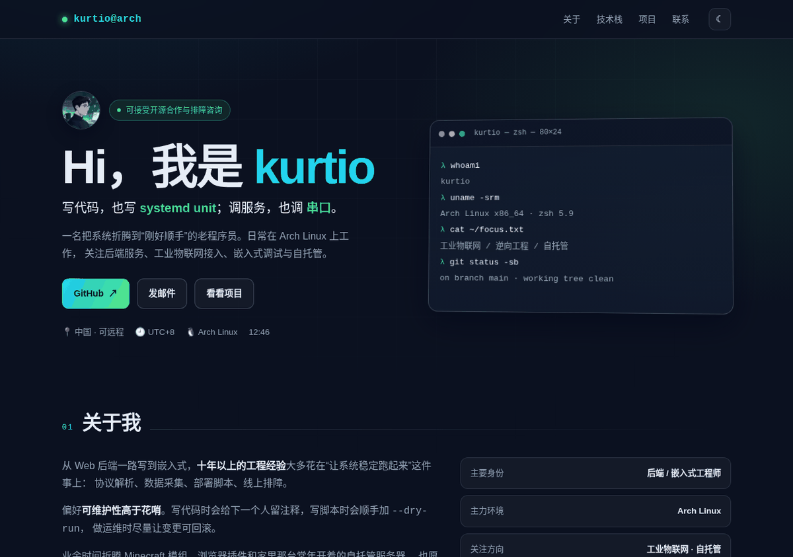

# kurtio.github.io

个人站点源码，直接用 GitHub Pages 托管：**https://kurtio.github.io**

零依赖、零构建：没有 npm、没有打包器、没有前端框架，`index.html` 里内联 CSS/JS，克隆下来双击就能看。



## 结构

```text
kurtio.github.io/
├── index.html                  # 首页（内联 CSS + JS）
├── 404.html                    # 自定义 404
├── assets/
│   ├── avatar.png              # 头像（首屏与 apple-touch-icon）
│   └── favicon.svg             # 站点图标
├── .nojekyll                   # 跳过 Jekyll，按纯静态发布
├── .github/workflows/pages.yml # Actions 部署 Pages
├── README.md
├── LICENSE
└── .gitignore
```

## 本地预览

```bash
python3 -m http.server 8000
# 浏览器打开 http://localhost:8000
```

直接 `file://` 打开 `index.html` 也能正常显示（没有 `fetch`、没有外链资源）。

## 部署

仓库推到 `kurtio/kurtio.github.io` 后，在 **Settings → Pages → Build and deployment** 把 Source 选成 **GitHub Actions**（不要选 Deploy from a branch）。随后推 `main` 触发 `pages.yml`，首次发布约 1 分钟生效。

如果沿用默认的 `Deploy from a branch`（`main` / root），也可以直接发布；两条路只需选一条，不要同时用。

仓库名必须是 `kurtio.github.io`，而且仓库公开，Pages 才会绑定到根域名。

## 内容维护

| 想改什么 | 改哪里 |
| --- | --- |
| 姓名、标语、简介 | `index.html` 里 `<h1 class="name">` 与 `.desc` |
| 首屏终端演示的命令 | `index.html` 底部脚本里的 `cmds` 数组，以及 `.line` 的 `data-out` |
| 技术栈分组 | `<section id="stack">` 里四个 `.stack-card` |
| 项目卡片 | `<section id="projects">` 里的 `<article class="proj">`，把标题、描述、标签换成真实仓库 |
| 联系方式 | `#contact` 区块的 `mailto:` 与 `data-mail`，两处要一起改 |
| 配色 | `<style>` 顶部的 `:root` 变量（深色）；`html[data-theme="light"]`（浅色） |
| 导航项 | `#navLinks` 的链接 + `<section>` 的 `id`，两边保持一致 |

## 已实现 / 未实现

- ✅ 深色 / 浅色切换，选择存 `localStorage`
- ✅ 首屏逐字输入动画，尊重 `prefers-reduced-motion`
- ✅ 滚动入场、导航随滚动高亮、移动端菜单
- ✅ 复制邮箱（Clipboard API + `execCommand` 兜底）
- ✅ 自定义 404、SVG 图标
- ❌ 没有博客 / 文章列表（需要的话加 `posts/` 并引入静态生成器）
- ❌ 没有评论、统计、RSS

## 注意

- `index.html` 里的邮箱、GitHub 链接都是占位，上线前确认一遍。
- 不要在仓库里放 `.env`、私钥或 Token；`.gitignore` 已经兜底，但历史提交不会自动清理。
